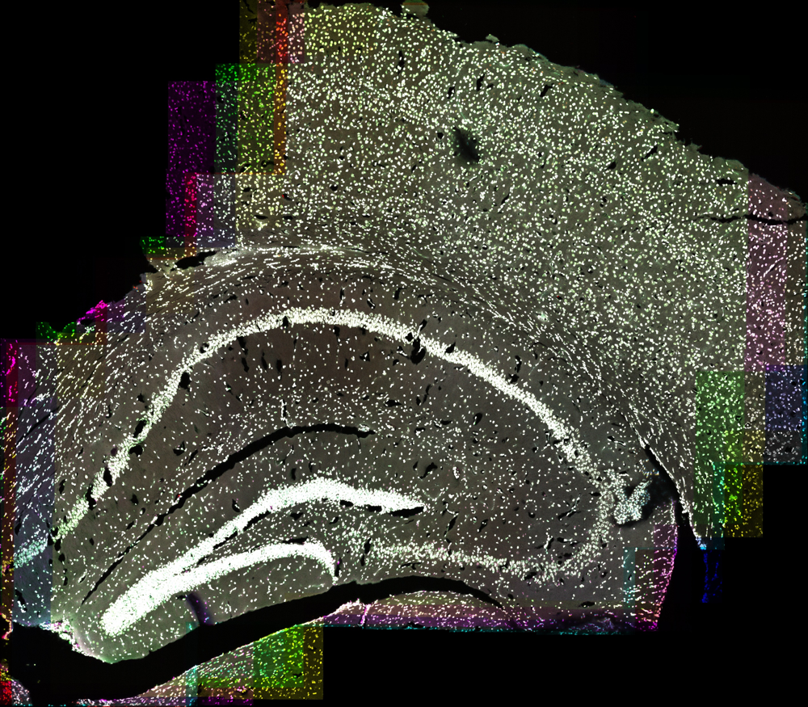

# IBEX-PyReg

IBEX-PyReg lines up the imaging cycles of a multiplex immunofluorescence (IBEX)
experiment, so every marker sits on the same cells. It uses the DAPI channel of each cycle as
the reference. It first corrects the XY shift by phase cross-correlation, then corrects tissue
warping with deformable registration in ANTs.



*24 DAPI channels from one mouse brain section, overlaid after registration with IBEX-PyReg.*

## How it works

`pyreg.py` runs two steps for each cycle after the first:
1. Coarse XY translation via phase cross-correlation.
2. Deformable refinement via ANTsPyx SyN registration.

Outputs are saved to a `reg_output/` subfolder inside each input directory.

## Requirements

- Python packages: `numpy`, `tifffile`, `antspyx`, `scikit-image`, `scipy`

## Usage

```bash
python pyreg.py <input_dir> [<input_dir> ...]
```

- `input_dir`: one or more directories containing cycle TIFF stacks

Examples:

```bash
python pyreg.py sample_A
python pyreg.py sample_A sample_B
python pyreg.py data --crop_size 1024 --threads 8
python pyreg.py data --axes ZCYX --dapi_channel 0
```

## Options

- `--crop_size N` center crop size for phase-correlation pre-alignment (default: `2048`)
- `--threads N` ITK/ANTs thread count (default: `4`)
- `--axes MODE` input axis mode: `auto`, `ZCYX`, or `CZYX` (default: `auto`)
- `--dapi_channel N` channel index used as DAPI reference (default: `0`)

## Notes

- The first TIFF stack in each directory is treated as the fixed reference cycle.
- Input stacks must be 4D and represent either `ZCYX` or `CZYX` layouts.
- In `auto` axis mode, ambiguous small-dimension stacks may still require explicit `--axes`.
- Output TIFF is written in ImageJ-compatible `TZCYX` layout.
